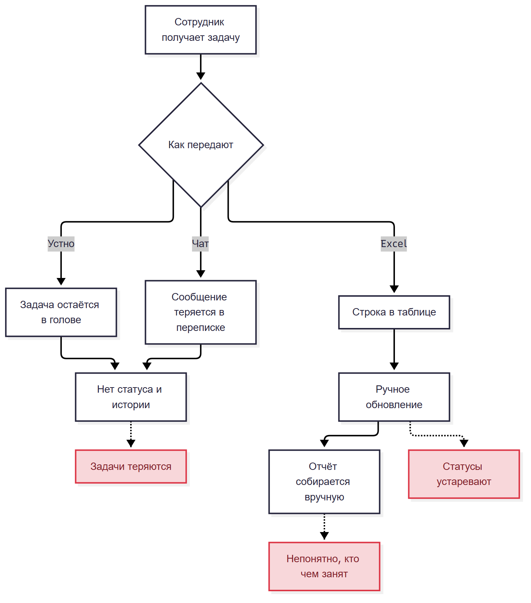
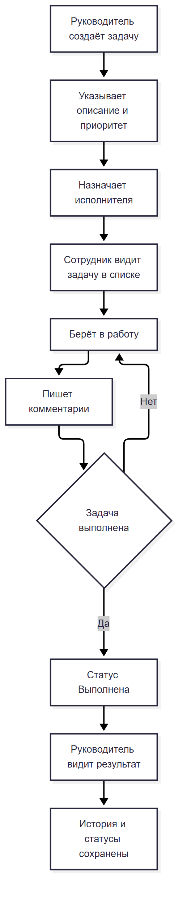

# Этап 1. Анализ предметной области

## 1.1. Описание

TaskBoard автоматизирует учёт задач небольшой команды. Сейчас задачи передаются устно, в чатах или в Excel. Из-за этого непонятно, кто чем занят, какие задачи просрочены и что уже сделано. Руководитель не видит общую картину, а сотрудники переспрашивают статусы.

Система собирает задачи в одном месте. Руководитель создаёт задачу, указывает описание, приоритет и исполнителя. Сотрудник видит свои задачи, берёт их в работу, пишет комментарии и меняет статус. Администратор управляет пользователями.

Границы проекта: задачи, комментарии, статусы, роли и простая сводка. Отчёты, уведомления, вложения и календарь в первую версию не входят.

## 1.2. Роли

| Роль | Функции | Действия | Результат |
| --- | --- | --- | --- |
| Администратор | Управление доступами | Создаёт пользователей, отключает их, видит все задачи | Система настроена, доступы ограничены |
| Руководитель | Постановка задач | Создаёт задачи, назначает исполнителей, меняет статусы | Задачи распределены, статусы видны |
| Сотрудник | Выполнение задач | Смотрит свои задачи, комментирует, меняет статус | Понятно, что делать и на каком этапе задача |

## 1.3. AS-IS

Задача передаётся устно или в чате. Статус хранится в голове или в переписке. Иногда ведётся Excel, но его обновляют вручную. Руководитель узнаёт о проблемах постфактум.

## 1.4. TO-BE

Руководитель создаёт задачу в системе. Сотрудник видит её в списке, берёт в работу и отмечает выполнение. Все комментарии и статусы сохраняются. Руководитель видит, кто чем занят.

## 1.5. Модель проектирования

Выбран смешанный подход: объектно-ориентированный для сущностей и функционально-модульный для структуры.

Причины:

1. Есть понятные сущности: пользователь, задача, комментарий.
2. Система делится на модули: вход, задачи, комментарии, статусы, администрирование.
3. Задача проходит понятный жизненный цикл.
4. Для учебного проекта важна наглядность: Use Case, ERD, схема модулей.
5. Проект небольшой, поэтому тяжёлые подходы вроде микросервисов не нужны.

## 1.6. Вывод

Предметная область описана, роли выделены, текущий и целевой процессы зафиксированы. Выбран смешанный подход, который подходит для небольшой системы с ролями и статусами.
