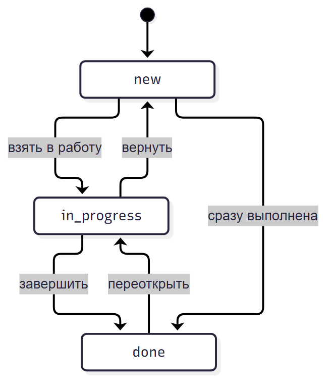

# Этап 3. Техническое задание

## 3.1. Общие сведения

| Поле | Значение |
| --- | --- |
| Система | TaskBoard |
| Назначение | Учёт задач небольшой команды |
| Студент | Гущин Даниил, группа 9/4-РПО-23/1 |
| Модули | ПМ.02, ПМ.03 |
| Результат | Рабочее веб-приложение, Docker-образ, тесты, документация |

## 3.2. Цель

Дать команде единое место для задач, статусов и комментариев. Заменить ручной учёт в чатах и Excel.

## 3.3. Роли

| Действие | Администратор | Руководитель | Сотрудник |
| --- | --- | --- | --- |
| Создать задачу | Да | Да | Да, себе |
| Смотреть все задачи | Да | Да | Нет |
| Смотреть свои задачи | Да | Да | Да |
| Назначить исполнителя | Да | Да | Нет |
| Менять статус | Да | Да | Только своей задачи |
| Комментировать | Да | Да | Да |
| Управлять пользователями | Да | Нет | Нет |

## 3.4. Функции

1. Вход и выход.
2. Создание задачи.
3. Список задач с фильтрами по статусу и исполнителю.
4. Карточка задачи.
5. Комментарии.
6. Смена статуса.
7. Назначение исполнителя.
8. Управление пользователями.
9. Сводка на главной.
10. Healthcheck.

## 3.5. Статусы

| Статус | Значение |
| --- | --- |
| Новая | Задача создана |
| В работе | Исполнитель начал работу |
| Выполнена | Работа завершена |

Допустимые переходы:

- Новая → В работе;
- Новая → Выполнена;
- В работе → Выполнена;
- В работе → Новая;
- Выполнена → В работе.

## 3.6. Данные

| Сущность | Данные |
| --- | --- |
| Пользователь | id, email, имя, хеш пароля, роль, активность, дата создания |
| Задача | id, название, описание, статус, приоритет, автор, исполнитель, даты |
| Комментарий | id, задача, автор, текст, дата |

## 3.7. Среда

| Компонент | Выбор | Причина |
| --- | --- | --- |
| Язык | Python 3.12 | Уже установлен, быстро |
| Фреймворк | FastAPI | Простой роутинг и шаблоны |
| ORM | SQLModel | Меньше кода |
| База | SQLite и PostgreSQL | SQLite локально, PostgreSQL в Docker |
| Шаблоны | Jinja2 | Без отдельного фронтенда |
| Стили | Bootstrap | Быстрый адаптивный интерфейс |
| Тесты | pytest | Стандарт для Python |
| Линтер | ruff | Быстрый и строгий |
| Контейнеры | Docker Compose | Воспроизводимый запуск |
| CI | GitHub Actions | Проверки на каждый пуш |
| Релиз | GHCR | Бесплатный registry для публичного образа |

## 3.8. Критерии приёмки

1. Приложение запускается локально.
2. Docker Compose поднимает приложение и PostgreSQL.
3. Release build запускается из GHCR.
4. 16 тестов проходят.
5. ruff не находит ошибок.
6. `/health` возвращает 200.
7. Основной сценарий работает.
8. Документы УП02 и УП03 собраны.

## 3.9. Вывод

ТЗ фиксирует небольшой, но полный набор функций. Его достаточно для УП02 и УП03, и он не требует платных сервисов.
