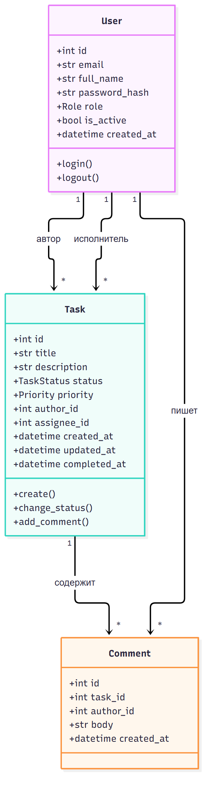
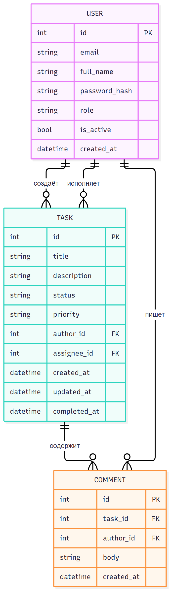

# Этап 4. Классы, атрибуты, операции и данные

## 4.1. Классы

| Класс | Назначение |
| --- | --- |
| User | Учётная запись и роль |
| Task | Задача |
| Comment | Комментарий к задаче |

## 4.2. Атрибуты и операции

| Класс | Атрибуты | Операции | Связи |
| --- | --- | --- | --- |
| User | id, email, full_name, password_hash, role, is_active, created_at | Вход, выход, проверка пароля, отключение | Создаёт задачи, исполняет задачи, пишет комментарии |
| Task | id, title, description, status, priority, author_id, assignee_id, created_at, updated_at, completed_at | Создать, назначить, сменить статус, комментировать | Принадлежит автору и исполнителю, содержит комментарии |
| Comment | id, task_id, author_id, body, created_at | Добавить, прочитать | Принадлежит задаче и автору |

## 4.3. Словарь данных

| Сущность | Поле | Тип | Обязательное |
| --- | --- | --- | --- |
| User | id | integer | Да |
| User | email | string | Да |
| User | full_name | string | Да |
| User | password_hash | string | Да |
| User | role | enum | Да |
| User | is_active | boolean | Да |
| User | created_at | datetime | Да |
| Task | id | integer | Да |
| Task | title | string | Да |
| Task | description | text | Да |
| Task | status | enum | Да |
| Task | priority | enum | Да |
| Task | author_id | integer | Да |
| Task | assignee_id | integer | Нет |
| Task | created_at | datetime | Да |
| Task | updated_at | datetime | Да |
| Task | completed_at | datetime | Нет |
| Comment | id | integer | Да |
| Comment | task_id | integer | Да |
| Comment | author_id | integer | Да |
| Comment | body | text | Да |
| Comment | created_at | datetime | Да |

## 4.4. Входные данные

| Данные | Источник | Формат |
| --- | --- | --- |
| Email и пароль | Пользователь | Форма |
| Название и описание задачи | Пользователь | Форма |
| Приоритет и исполнитель | Пользователь | Выпадающие списки |
| Комментарий | Пользователь | Текст |
| Новый статус | Пользователь | Выпадающий список |
| Данные нового пользователя | Администратор | Форма |

## 4.5. Выходные данные

| Данные | Получатель | Формат |
| --- | --- | --- |
| Сводка | Все роли | HTML |
| Список задач | Все роли | HTML-таблица |
| Карточка задачи | Все роли | HTML |
| Комментарии | Все роли | HTML |
| Статус здоровья | Мониторинг | JSON |

## 4.6. Схема классов

## 4.7. ERD

## 4.8. Вывод

Модель данных минимальна и покрывает все функции ТЗ. Три сущности достаточно, чтобы хранить пользователей, задачи и обсуждение.
