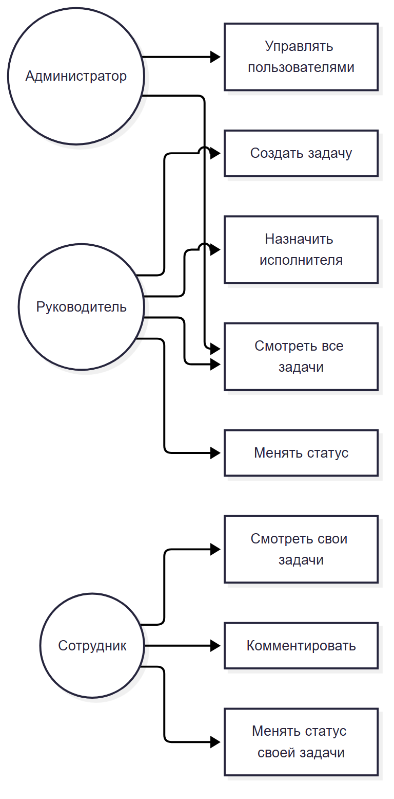
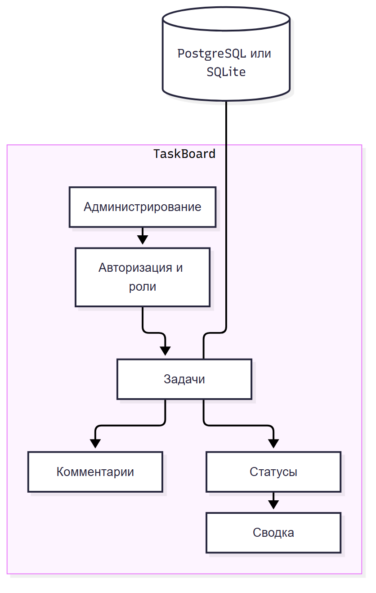
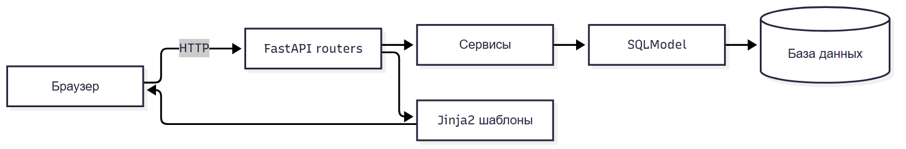

# Этап 5. Ассоциации и декомпозиция

## 5.1. Ассоциации

| Сущность A | Связь | Сущность B | Кардинальность | Смысл |
| --- | --- | --- | --- | --- |
| User | создаёт | Task | 1 ко многим | Автор задачи |
| User | исполняет | Task | 1 ко многим | Назначенный исполнитель |
| Task | содержит | Comment | 1 ко многим | Обсуждение задачи |
| User | пишет | Comment | 1 ко многим | Автор комментария |

## 5.2. Use Case

## 5.3. Декомпозиция

| Блок | Что включает | Назначение |
| --- | --- | --- |
| Авторизация | Вход, выход, сессия, роли | Доступ |
| Задачи | Создание, список, карточка, фильтры | Основная работа |
| Комментарии | Добавление и просмотр | Обсуждение |
| Статусы | Допустимые переходы | Жизненный цикл задачи |
| Администрирование | Пользователи | Управление доступами |
| Сводка | Счётчики по статусам | Быстрый обзор |

## 5.4. Взаимодействие модулей

Запрос идёт так: браузер → роутер → сервис → модель → база. Ответ возвращается через шаблон.

## 5.5. Принцип декомпозиции

Система разделена по ответственности:

- роли: администратор, руководитель, сотрудник;
- функции: задачи, комментарии, статусы, администрирование;
- слои: HTTP, бизнес-логика, данные, представление.

Такой вариант удобно тестировать и объяснять.

## 5.6. Вывод

Связи между сущностями простые и понятные. Декомпозиция покрывает все функции ТЗ и не создаёт лишних модулей.
