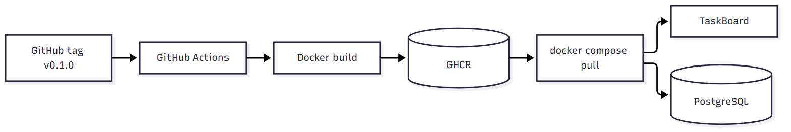

# УП03. Развёртывание через release build

## 1. Почему release build

По ТЗ развёртывание можно сделать через VPS или PaaS, либо подготовить release build. Выбран release build, потому что:

- нет своего сервера;
- нет платных сервисов и бесплатных тарифов с ограничениями;
- образ хранится в GitHub Container Registry;
- любой человек с Docker может запустить проект одной командой;
- для DevOps это показывает сборку, версионирование и поставку артефакта.

Внешние PaaS не используются.

## 2. Схема



## 3. Как выпускается образ

По тегу `v*` запускается `.github/workflows/release.yml`:

1. GitHub Actions собирает Docker-образ.
2. Логинится в GHCR через `GITHUB_TOKEN`.
3. Пушит теги `v0.1.0` и `latest`.

Образ:

```text
ghcr.io/shargabong/taskboard:v0.1.0
```

## 4. Как запустить

```powershell
docker compose -f docker-compose.release.yml up -d
```

Проверка:

```powershell
docker compose -f docker-compose.release.yml ps
```

Ожидание: `app` healthy, `db` healthy.

Проверка приложения:

```text
GET http://127.0.0.1:8000/health -> 200 {"status":"ok","environment":"production"}
```

## 5. Что входит в релиз

- образ приложения;
- PostgreSQL 16;
- `docker-compose.release.yml`;
- `.env.production.example`;
- `RELEASE_NOTES.md`;
- `CHANGELOG.md`;
- инструкция запуска.

## 6. Локальная проверка

Образ собран локально и запущен через release compose:

```text
taskboard-app-1   ghcr.io/shargabong/taskboard:v0.1.0   Up (healthy)
taskboard-db-1    postgres:16-alpine                     Up (healthy)
GET /health -> 200, production
```

## 7. Откат

Откат на предыдущую версию:

1. Изменить тег образа в `docker-compose.release.yml`.
2. Выполнить `docker compose -f docker-compose.release.yml up -d`.
3. Проверить `/health`.

## 8. Ограничения

- образ нужно обновлять вручную, автоматом он не подтягивается;
- база одна, без репликации;
- TLS не входит в compose, при выкладке на VPS нужен reverse proxy;
- демо-пароли включены.

## 9. Вывод

Release build полностью закрывает этап развёртывания без платных сервисов. Образ воспроизводим, версионируется и запускается одной командой.
