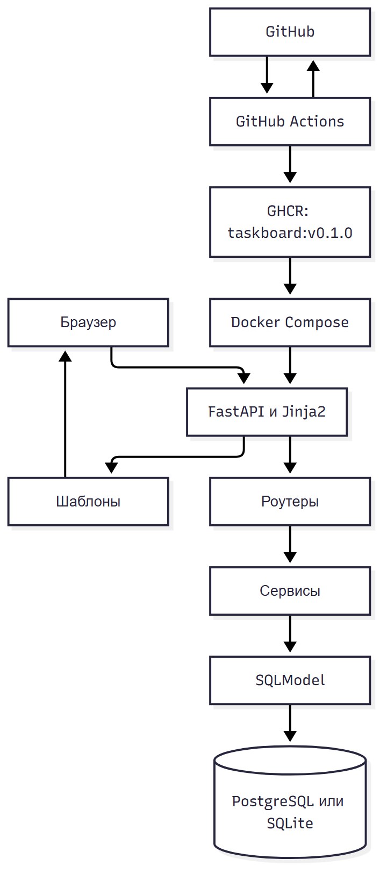

# УП03. Входной аудит проекта

## 1. Паспорт

| Поле | Значение |
| --- | --- |
| Проект | TaskBoard |
| Студент | Гущин Даниил, 9/4-РПО-23/1 |
| Модуль | ПМ.03, сопровождение ПО |
| Репозиторий | https://github.com/shargabong/taskboard |
| Стадия | Рабочий прототип, готов к release build |
| Платные сервисы | Не используются |

## 2. Что есть

| Компонент | Состояние |
| --- | --- |
| Приложение | Работает |
| Вход и роли | Работают |
| Задачи и комментарии | Работают |
| Статусы | Работают |
| Админка | Работает |
| Тесты | 16 |
| Линтер | Чисто |
| Docker | App и PostgreSQL поднимаются |
| Release build | Образ собран локально |
| CI | Готов |
| Документация | Готова |

## 3. Стек

| Компонент | Версия |
| --- | --- |
| Python | 3.12.10 |
| FastAPI | 0.162.0 |
| SQLModel | 0.0.48 |
| Uvicorn | 0.54.0 |
| Jinja2 | 3.1.6 |
| pytest | 8.4.2 |
| ruff | 0.17.3 |
| PostgreSQL | 16 |
| Docker | 29.9.2 |

## 4. Модули

| Модуль | Файлы |
| --- | --- |
| Конфигурация | `app/config.py` |
| База | `app/db.py` |
| Модели | `app/models.py` |
| Безопасность | `app/security.py` |
| Роли | `app/dependencies.py` |
| Вход | `app/routers/auth.py` |
| Задачи | `app/routers/tasks.py`, `app/services/tasks.py` |
| Админка | `app/routers/admin.py` |
| Шаблоны | `app/templates/` |

### Карта компонентов



### Структура проекта

```text
taskboard/
  app/
    main.py
    config.py
    db.py
    models.py
    security.py
    dependencies.py
    routers/
      auth.py
      tasks.py
      admin.py
    services/
      tasks.py
    templates/
    static/
  tests/
  scripts/
  docs/
  Dockerfile
  docker-compose.yml
  docker-compose.release.yml
  .github/workflows/ci.yml
  .github/workflows/release.yml
```

## 5. Данные

| Таблица | Записей |
| --- | --- |
| user | 4 |
| task | 6 |
| comment | 3 |

Одна задача создана smoke-тестом, это нормально для демо.

## 6. Конфигурация

| Переменная | Значение |
| --- | --- |
| `TASKBOARD_ENVIRONMENT` | development |
| `TASKBOARD_DEBUG` | false |
| `TASKBOARD_SECRET_KEY` | dev-secret-change-me |
| `TASKBOARD_DATABASE_URL` | sqlite:///./data/taskboard.db |
| `TASKBOARD_SESSION_HTTPS_ONLY` | false |
| `TASKBOARD_SEED_DEMO` | true |

## 7. Порты

| Сервис | Порт |
| --- | --- |
| Приложение | 8000 |
| PostgreSQL в Docker | 5432 |
| Release compose | 8000, база наружу не публикуется |

## 8. Чего не хватает

| Пробел | План |
| --- | --- |
| Нет GitHub-репозитория | Создать `taskboard` |
| Образ не загружен в GHCR | Тег `v0.1.0`, workflow release |
| Нет CSRF | Доработать перед production |
| Нет мониторинга | Healthcheck и внешний аптайм позже |

## 9. Вывод

Проект готов к упаковке и релизу. Основные модули работают, тесты и Docker проверены. Осталось создать репозиторий, загрузить образ в GHCR и собрать документы.
